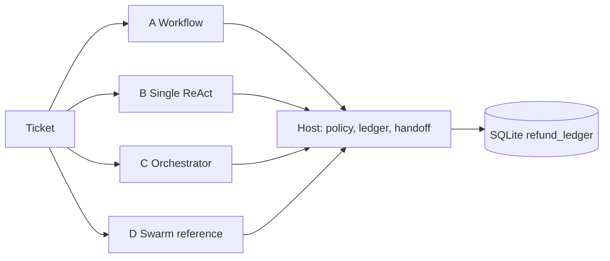

# Architecture

Tài liệu tham khảo về bốn shape và ranh giới code / model. Nhóm mô tả kiến trúc **của mình** ở mục 3 "Giải pháp" trong [`report/team/group_report.md`](../report/team/group_report.md). Báo cáo cả nhóm không quá 5 trang ngoài phụ lục.

## Bốn shape

- A — bước cố định trong Python. Model chỉ được soạn câu chữ. Tiền do `compute_compensation`.
- B — một vòng ReAct, tối đa 8 bước. Host kiểm tool và là người ghi duy nhất.
- C — orchestrator điều phối investigator chỉ có tool đọc, nhận handoff allowlist. Trong bản nhóm, danh sách tool đã được code xác định và investigator chạy tuần tự.
- D — swarm có sẵn. Đo cost và variance. Không coi là shape thắng sẵn.

## Ranh giới

| Việc | Ai quyết |
| --- | --- |
| Lọc theo principal, policy hiệu lực, trần tiền | Code |
| Xác định needs_info/escalated trong bản nhóm | Code dựa vào order_id, found và phạm vi principal; không suy từ chữ trong ticket |
| Soạn câu chữ hoặc phân tích ngôn ngữ nếu có | MockLLM trong giới hạn; không được thay dữ kiện order, policy, approval hoặc số tiền |
| Approval, idempotency, ghi refund | Code, một transaction |
| Trần hoàn tiền theo đơn (trừ phần claim trước đã nhận) | Code, đọc lại tổng trong cùng transaction ghi |
| Approval có thuộc đúng claim không | Code (`claims.approval_id` → `approvals.claim_id`) |
| Duyệt hay không | Approval event do host gắn, không do model tạo |
| Retry sau crash | Ledger, không phải checkpoint đơn độc |

## Handoff

`handoff.v1` chỉ còn các field allowlist. `parent_secret`, header, history, và tool ghi không được có mặt. Tóm tắt bằng LLM không tính là redaction.

## Triển khai và giới hạn so sánh của nhóm

Nhóm chọn **workflow mặc định** theo [ADR](../report/team/decision_adr.md). Cả ba shape đạt 70/70 trial public; điều này chưa chứng minh bằng nhau trên hidden. `single.decide` chọn hành động bằng Python, chuỗi MockLLM không quyết định tool; orchestrator cũng chưa đo lợi ích chạy song song.

Budget do từng shape ghi nhận. Workflow tính tool cost trước yêu cầu refund; single/orchestrator chưa ghi cost cho thao tác đó. Do đó cost trong benchmark mô tả instrumentation hiện tại, không tách riêng hiệu ứng topology. `steps` là số event trace, không phải độ trễ hoặc số vòng suy luận.

Crash suite chuẩn kiểm host và swarm. T11/T12 của ma trận student cùng test riêng mới kiểm crash/resume trực tiếp shape của nhóm; không dùng riêng `crash.json` để thay thế các test này.
